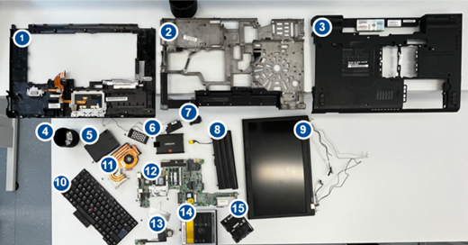
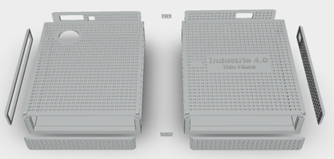
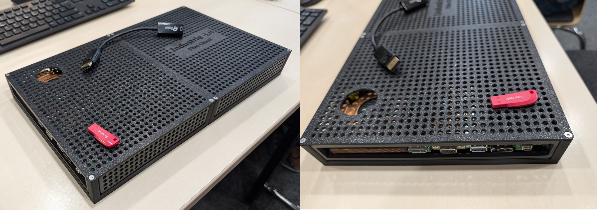

# Documentation of the Practical Repurposing Process

This directory provides visual documentation of the practical repurposing of a Lenovo ThinkPad W510 into a thin client.

## R03 – Disassembly

Disassembled components of the original notebook.

The [Component List](Component%20List) identifies the numbered components and indicates which components were reused in the demonstrator.

## R06 – Enclosure Design

Exploded view of the newly designed enclosure for the selected notebook components.

## R10 – Final Demonstrator

Assembled thin-client demonstrator integrating the selected notebook components into the newly designed enclosure.

